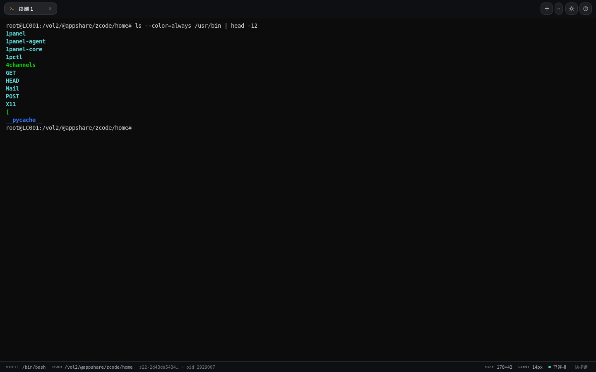
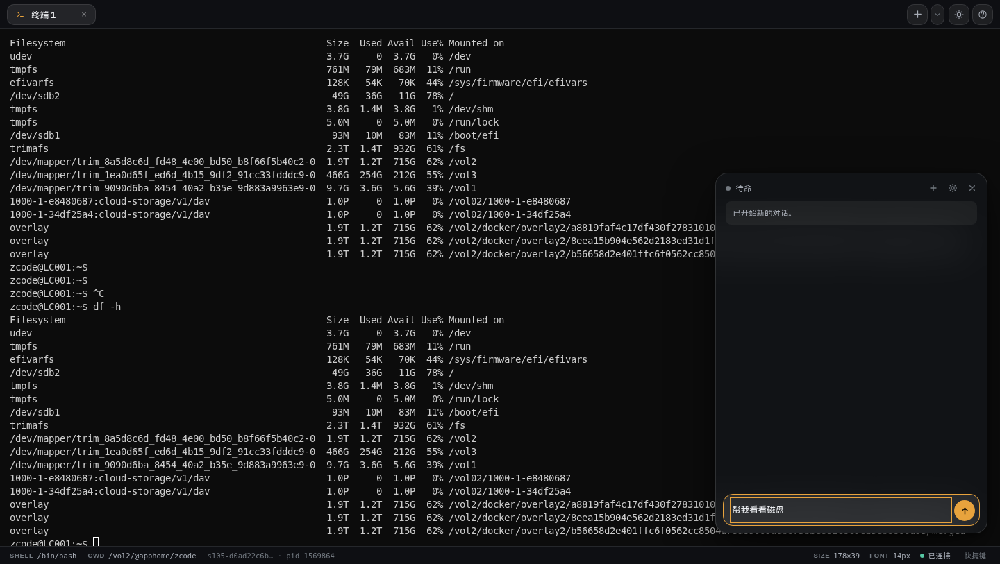

# Web 终端（nas-webterm / nas-webterm-ai）

飞牛 fnOS 里的浏览器式多标签终端：打开浏览器就能用 root shell，关掉页面任务还在跑。



<p align="center"></p>

> 这个项目有两个版本，**同一个仓库**：
>
> - **普通版** `nas-webterm`：只有终端，源码里没有任何 AI 代码。
> - **AI 版** `nas-webterm-ai`：终端 + 右下角 AI 助手（对话、执行命令、聊天记录）。
>
> 两个版本的 appname 不同，可以同时装在一台 NAS 上。

更短的使用说明见 [docs/使用教程.md](docs/使用教程.md)。

---

## 1. 怎么用（3 分钟上手）

### 安装

1. 从 [Releases](https://github.com/Xinghe-0203/nas-webterm/releases) 下载最新的 `.fpk`；
   也可以自己构建（见第 6 节，产物在 `dist/`）。两个版本任选一个：

   - 普通版：`nas-webterm-1.2.6.fpk`
   - AI 版：`nas-webterm-ai-1.2.6.fpk`

2. 打开飞牛：**应用中心 → 我的应用 → 手动安装**，选对应的 `.fpk`。
3. 安装向导直接点下一步（默认值即可）。
4. 回到桌面，点 **Web 终端** / **Web 终端 AI** 图标。

> 桌面图标只对**管理员**显示。这个应用提供 root shell，这是刻意设计。

### 第一次打开

- 页面就是一个终端，直接敲命令，和你用 SSH 一样。
- 左上角 `+` 新建标签页；每个标签页是一个独立 shell。
- 关掉浏览器/刷新页面：后台终端不会死，重新打开会自动接回来。
- 关闭标签页：这个终端里的进程会被一起结束。

### AI 版怎么用

1. 点右上角 **⚙**（或按 `Ctrl+Alt+A`）。
2. 填三样东西：
   - 接口地址：例如 `https://api.deepseek.com/v1`
   - API Key
   - 模型名：例如 `deepseek-chat`
3. 保存，然后直接在右下角聊天框里说：
   - 「看看磁盘满了吗」
   - 「把 /tmp 里三天前的日志删掉」
   - 「装一下 htop」
4. AI 会先说明，再给出命令：
   - 查询类命令自动执行；
   - 删除、覆盖文件、关机这类危险命令会弹卡片，点 **执行** 才跑。
5. 命令卡片点标题可以展开，看到完整命令和这次的实际输出。
6. 面板顶部的 **时钟按钮** 是聊天记录：刷新页面、换浏览器都还在，可以点开以前的对话继续聊。

> **手机切后台、锁屏、网络抖动都不会弄丢任务**：连接断了会自动重连，
> 断开期间的内容会补发回来，不会重复也不会少。离开超过 2 分钟任务才真正结束
> （期间不会执行新命令）。

> AI 的 API Key 只存在 NAS 服务端（`${TRIM_PKGVAR}/ai.json`，权限 `0600`），不会发到浏览器。

### 常用快捷键

| 按键 | 作用 |
| --- | --- |
| `Ctrl+Shift+T` | 新建标签页 |
| `Ctrl+Shift+W` | 关闭当前标签页 |
| `Ctrl+Tab` | 下一个标签页 |
| `Ctrl+Alt+K` | 显示 / 收起 AI 面板 |
| `Ctrl+Alt+A` | 打开 AI 设置 |
| `Shift+Enter` | 把输入强制当自然语言发给 AI |
| `Ctrl+Shift+C` / `Ctrl+Shift+V` | 复制 / 粘贴 |
| `Ctrl +` / `-` / `0` | 放大 / 缩小 / 重置字号 |

---

## 2. 功能

| 能力 | 说明 |
| --- | --- |
| 多标签 | 每个标签独立 shell，关闭即结束整棵进程树 |
| root shell | 默认以 root 启动，`docker`、`systemctl` 等直接可用 |
| 断线不丢 | 关页面/断网后终端继续跑，重连回放最近输出并接回原会话 |
| 全屏 TUI | vim / htop / top 等全屏程序关掉页面再打开也能正确重建 |
| 真彩色 | 256 色 / truecolor、鼠标、括号粘贴、中日韩宽度 |
| 内置 Nerd Font | oh-my-posh / starship 图标正常显示，不会变方块 |
| 深/浅主题 | 一键切换并记住 |
| 进程守护 | 服务异常退出后自动重启；关标签页回收整棵进程树 |
| AI 助手（AI 版） | 自然语言 → 命令 → 审批 → 执行 → 回灌输出 → 总结 |
| 聊天记录（AI 版） | 每轮对话落盘；刷新/换设备还在；可打开历史继续聊 |
| 断线不丢任务（AI 版） | 手机切后台 / 网络抖动时任务不中断，自动重连续上，输出不丢不重 |
| 长期记忆（AI 版） | 模型用 `<remember>` 记住重要信息，跨会话保留 |

### 两个版本的区别

| | 普通版 | AI 版 |
| --- | --- | --- |
| appname | `nas-webterm` | `nas-webterm-ai` |
| 终端 | ✅ | ✅ |
| 右下角 AI 面板 | ❌ | ✅ |
| AI 代码 | 编译期完全不进二进制/包 | ✅ |
| 适合 | 只要终端、不想带大模型配置 | 想让 AI 帮忙看机器/执行命令 |

> 「普通版不含 AI」不是运行起来隐藏，而是构建时就把 `rust/src/ai/` 和 `web/src/ai/`
> 从源码与产物里删掉；`build.sh` 会检查二进制和前端里没有任何 AI 字符串。

---

## 3. 设置

安装后在 **应用中心 → Web 终端 → 设置** 里改，修改会保存并自动重启服务。

| 字段 | 默认 | 说明 |
| --- | --- | --- |
| 默认 Shell | `/bin/bash` | 新标签页启动的 shell，也可填 zsh / fish |
| 默认工作目录 | `/root` | 不存在时自动回退 |
| 启动后自动执行的命令 | 空 | 想常驻某个程序时填；留空就是普通 shell |
| 会话空闲回收（分钟） | `0` | `0` = 永不按时间回收，关页面后终端继续跑 |
| 最大同时会话数 | `32` | 达到上限拒绝新建，不会杀掉正在用的会话 |
| 严格校验管理员身份 | 开 | 只在网关行为异常时关闭 |

AI 版的模型设置（接口地址 / Key / 模型名 / 上下文窗口）在页面里的 **⚙** 中改。

---

## 4. 数据放在哪

安装后 `/var/apps/nas-webterm{,-ai}/` 是符号链接集合，真实路径由应用中心选择。

| 路径 | 内容 |
| --- | --- |
| `${TRIM_PKGVAR}/info.log` | 运行日志（超 8 MiB 自动轮转，保留 2 份） |
| `${TRIM_PKGVAR}/settings.env` | 安装设置 |
| `${TRIM_PKGVAR}/ai.json` | AI 配置（含 Key，`0600`，只存服务端） |
| `${TRIM_PKGVAR}/ai-memory.md` | 长期记忆 |
| `${TRIM_PKGVAR}/ai-history.json` | 聊天记录（最多 50 个会话 / 每个 200 轮） |
| `${TRIM_PKGVAR}/webterm.pid` | 服务进程号 |
| `${TRIM_PKGVAR}/webterm.sup.pid` | 守护进程号 |

看状态 / 重启：

```bash
sudo /var/apps/nas-webterm-ai/cmd/main status    # 0=运行中 3=已停止
sudo /var/apps/nas-webterm-ai/cmd/main restart
sudo tail -f /var/apps/nas-webterm-ai/var/info.log
```

健康检查：

```bash
curl -s --unix-socket /var/apps/nas-webterm-ai/app.sock \
  http://localhost/app/nas-webterm-ai/api/healthz
```

---

## 5. 常见问题

| 现象 | 处理 |
| --- | --- |
| 桌面没有图标 | 只有管理员可见，换管理员账号登录 |
| 打开显示 404 / not found | 应用没有在网关注册。到 **应用中心 → 我的应用 → Web 终端 → 停止 → 启动**，然后重新打开；不要用脚本直接 stop/start |
| 页面 403 | 非管理员；或「严格校验管理员身份」与网关不一致，临时关掉该开关 |
| 终端不出现 | 看 `info.log`，多为 shell 路径写错，改回 `/bin/bash` |
| 提示会话数已达上限 | 关掉不用的标签页，或调大「最大同时会话数」 |
| AI 输入没反应 | 先点 ⚙ 填接口地址 / Key / 模型名 |
| AI 一直不回 | 看 `info.log` 里 AI 相关行；检查 NAS 能否访问模型接口 |
| AI 命令执行了但终端没变化 | 命令写进当前标签页的 PTY，切到该标签页看，或展开命令卡片看输出 |
| AI 任务中途断了 | 手机切后台 / 网络抖动导致。1.2.6 起会自动重连续上，输出不丢；宽限期 120 秒内回来都能接上 |
| 升级后应用打不开 | 用 **应用中心 → 手动安装** 覆盖安装，不要用脚本直接 stop/start |
| 中文显示方块 | NAS 缺中文字体；浏览器侧问题，装 `fonts-wqy-zenhei` 可解决 |

---

## 6. 开发与构建

> 仓库不提交 `dist/`、二进制和前端产物，全部由构建脚本生成。

```bash
git clone https://github.com/Xinghe-0203/nas-webterm.git
cd nas-webterm
./build.sh --no-test        # 两个版本 + 双架构，产物在 dist/
./build.sh --variant ai     # 只构建 AI 版
./build.sh --with-browser   # 额外跑 headless 浏览器验证（需要 chromium）
```

依赖：

| 依赖 | 用途 |
| --- | --- |
| Rust 1.75+ | 后端 |
| Node.js 18+ | 前端 |
| gcc-aarch64-linux-gnu | 交叉编译 ARM（不装就加 `--arch x86_64`） |
| fnpack | 打 `.fpk`，脚本会自动下载 |
| chromium | 浏览器测试（可选） |

本地跑：

```bash
cd rust && cargo build --release
cd web && npm install && npx tsc --noEmit
./tools/dev.sh    # http://127.0.0.1:18086/app/nas-webterm/
```

目录：

```
nas-webterm/
├── manifest                 # 应用清单 / 版本 / changelog
├── cmd/                     # 安装、升级、启动、停止脚本
├── wizard/                  # 安装向导
├── rust/src/                # 后端：session / web / ai / agent / history / events / protocol
├── web/src/                 # 前端：终端、标签、AI 面板
└── tools/                   # 构建、测试、本地安装脚本
```

测试：

```bash
cd rust && cargo test                        # 后端单测（93 项）
node tools/verify-ai-history.mjs --url ...   # 聊天记录 22 项
node tools/verify-ai-history-ui.mjs --url ...# 聊天记录界面 22 项
node tools/verify-ai-resume.mjs --url ...    # 断线重连 21 项
node tools/verify-ai-resume-ui.mjs --url ... # 断线重连（浏览器）8 项
bash tools/verify-env-ownership.sh          # 环境变量归属 5 项
```

更多测试脚本见 `tools/verify-*.mjs`，每个脚本开头都有用法说明。

---

## 7. 安全

- 后端以 **root** 运行（为了 root shell）；不监听任何 TCP 端口，只走 Unix socket（`0600`）。
- 只对管理员显示桌面入口；服务端再校验网关注入的 `X-Trim-Isadmin`。
- 终端输入输出只走内存，不落盘、不上传；日志不记录终端内容。
- AI 的 Key 只存服务端 `0600` 文件，接口不下发；系统提示词由应用维护，不可在界面修改。
- 页面有 CSP（`default-src 'self'`），只允许同源资源。

---

## 8. 版本

当前 **1.2.6**，主要更新：

- 1.2.6：AI 任务断线自动重连（手机切后台不再丢输出）、协议标签不再污染聊天记录
- 1.2.5：AI 聊天记录持久化、聊天记录面板、刷新自动恢复
- 1.2.4：AI 命令执行可靠性（等命令真正结束、不重复循环）
- 1.2.3：按模型上下文自动分配预算、审批策略简化
- 1.2.2：进程守护、关标签页回收整棵进程树
- 1.2.1：标签栏同步全部会话、终端查询应答不污染输入框
- 1.2.0：拆分普通版 / AI 版

完整历史见 `manifest` 的 `changelog` 字段。

---

## 9. 许可证

MIT，见 `LICENSE`。

- 源码：https://github.com/Xinghe-0203/nas-webterm
- 架构：x86_64 + aarch64（同一个包通用）
